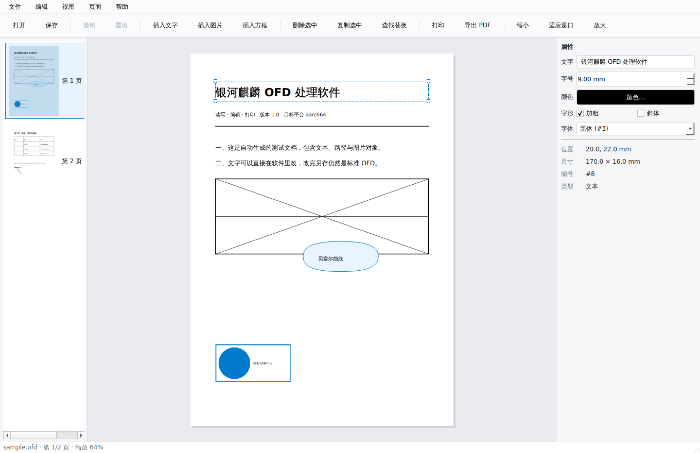
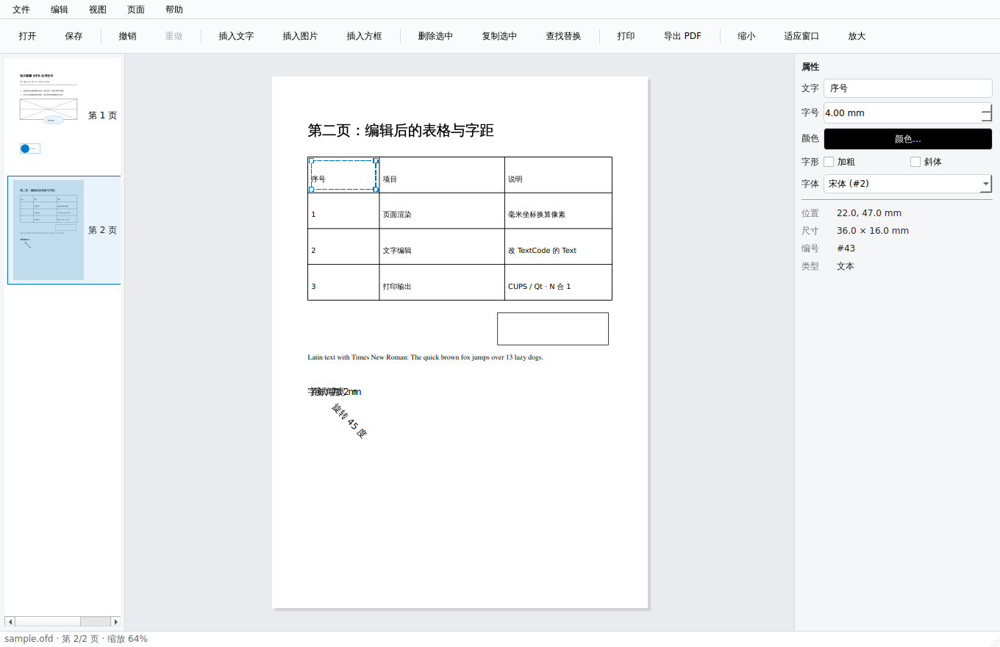
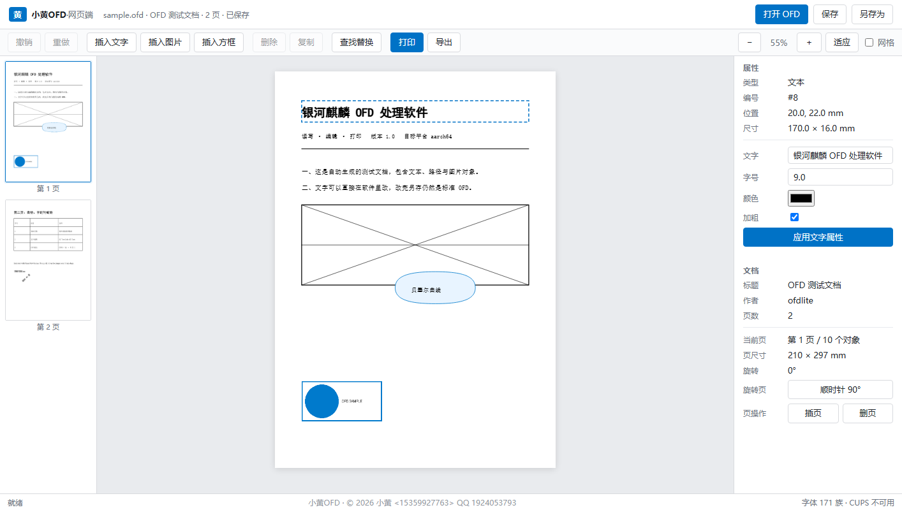
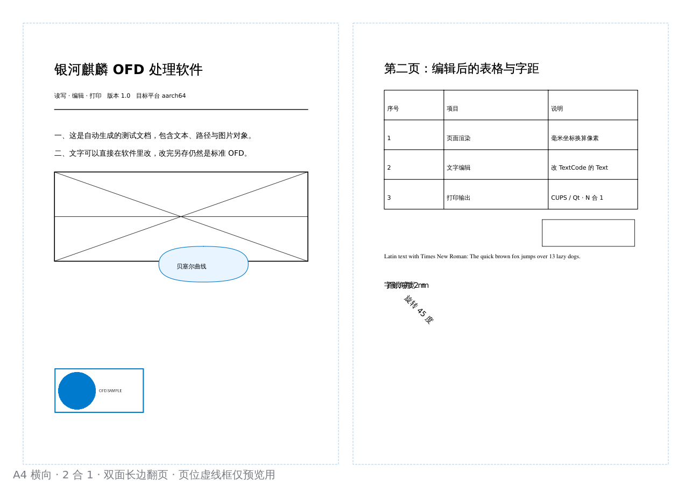
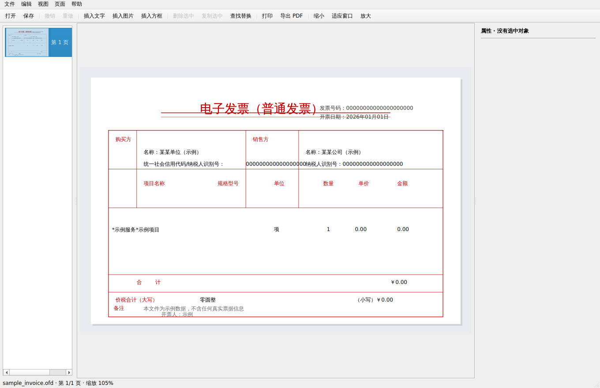

# 小黄OFD

[](LICENSE)
[](pyproject.toml)
[](docs/标准核对记录.md)

银河麒麟（以及其它 Linux 桌面）上的 OFD 文档读写与打印工具。三种形态共用同一套核心库：

| 形态 | 启动 | 适合 |
|------|------|------|
| 桌面端 | `ofd-editor` | 日常阅读、改字、拼版打印 |
| 网页端 | `ofd-web --open 文件.ofd` | 浏览器里改，或给不方便装桌面端的人用 |
| 命令行 | `ofd-cli` | 批量转 PDF/PNG、抽文本、脚本化打印 |

核心库是纯 Python（标准库 + Pillow），Qt 只用于桌面端界面，网页端用浏览器 Canvas 渲染。
桌面端、网页端、命令行输出同一份绘制指令，所以三处看到的内容一致。

## 界面

| | |
|---|---|
|  |  |
| 桌面端：阅读与属性面板 | 桌面端：编辑后的第二页 |
|  |  |
| 网页端：浏览器内 Canvas 渲染 | 打印：A4 横向 2 合 1 拼版预览 |

发票版式（210×140 mm，**图为合成数据样本 `tools/sample_invoice.ofd`，不含任何真实票据信息**）：


---

## 1. 快速开始

### 桌面端

```bash
python3 -m app.main                    # 空窗口，再打开文件
python3 -m app.main 合同.ofd            # 直接打开
```

依赖 Qt 绑定（PySide6 / PySide2 / PyQt5 任一）与 Pillow：

```bash
# 麒麟 V10（apt 里有的就用 apt，避免和系统 Qt 打架）
sudo apt install python3-pil python3-pyside2.qtcore python3-pyside2.qtgui \
                 python3-pyside2.qtwidgets python3-pyside2.qtprintsupport
# 或 pip
pip3 install PySide6 pillow
```

### 网页端

```bash
python3 web/server.py --open 合同.ofd        # 默认 127.0.0.1:8760
python3 web/server.py --host 0.0.0.0 --port 8080   # 内网共享时才这么起
```

浏览器打开 `http://127.0.0.1:8760`。只监听回环地址，没有账号体系；要让别人访问自己加 `--host`。

### 命令行

```bash
python3 tools/ofd_cli.py info   合同.ofd                 # 结构摘要
python3 tools/ofd_cli.py text   合同.ofd -o 合同.txt      # 抽文字
python3 tools/ofd_cli.py pdf    合同.ofd -o 合同.pdf --dpi 300
python3 tools/ofd_cli.py render 合同.ofd -o out/ --dpi 150
python3 tools/ofd_cli.py svg    合同.ofd -o out/
python3 tools/ofd_cli.py edit   合同.ofd --replace 旧公司名=新公司名 -o 新.ofd
python3 tools/ofd_cli.py print  合同.ofd --printer office --pages 1-3 --nup 2 --duplex
python3 tools/ofd_cli.py printers                        # 列 CUPS 打印机
```

### 源码安装（开发）

```bash
pip3 install pillow
python3 -m pip install PySide6          # 只有桌面端需要
```

---

## 2. 目录结构

```
OFD/
├── ofdlite/                   核心库（无 GUI 依赖，桌面端与网页端共用）
│   ├── __init__.py            对外 API
│   ├── model.py               OFD 包/文档/页/对象模型（XML 元素的薄包装）
│   ├── reader 逻辑内嵌于      model.OFDPackage.open()
│   ├── writer 逻辑内嵌于      model.OFDPackage.save()（只重写改动过的条目）
│   ├── xmlutil.py             命名空间宽容解析、数值宽容解析
│   ├── geometry.py            3x2 仿射矩阵、Boundary、路径解析、命中测试
│   ├── colors.py              颜色/色彩空间解析与回写
│   ├── font_manager.py        系统字体发现与 OFD 字体名映射
│   ├── scene.py               模型 → 绘制指令（协议的唯一定义处）
│   ├── render_pil.py          Pillow 后端（转图、导出 PDF、无界面预览）
│   ├── edits.py               编辑操作 + 撤销/重做（快照式）
│   ├── convert.py             导出 PDF / SVG / PNG / 文本 / 结构报告
│   ├── print_linux.py         CUPS 命令、N 合 1 拼版、小册子排页
│   └── errors.py              异常类型
├── app/                       桌面端（Qt）
│   ├── main.py                入口、QSS 主题
│   ├── mainwindow.py          主窗口、画布、属性面板、缩略图
│   ├── qt_renderer.py         QPainter 后端（与 Canvas/Pillow 同一协议）
│   └── print_dialog.py        打印对话框（CUPS 直发 / QPrinter / 生成 PDF）
├── web/                       网页端
│   ├── server.py              HTTP 服务 + REST API（标准库 http.server）
│   └── static/
│       ├── index.html         单页界面
│       ├── app.js             交互逻辑
│       ├── canvas.js          Canvas2D 渲染器
│       └── style.css          样式（UKUI 风格）
├── tools/
│   ├── make_sample_ofd.py     生成符合规范的测试 OFD
│   ├── ofd_cli.py             命令行工具
│   ├── selftest.py            核心库自测（20 项）
│   ├── qt_smoke.py            桌面端冒烟测试（11 项，offscreen）
│   ├── web_test.py            网页端接口自测（21 项）
│   ├── cdp_web_test.py        真实浏览器交互测试（10 项）
│   ├── real_sample_test.py    真实文件回归（无样本时跳过）
│   ├── std_gap_probe.py       造"已知不支持"的样本盯差距
│   ├── compare_render.py      与官方渲染做像素级对齐比对
│   ├── extract_xsd.py         从标准全文抽出附录 A 的 14 个 XSD
│   └── validate.py            用标准 XSD 校包内 XML
├── docs/
│   ├── GBT_33190-2016.pdf     标准原文（132 页，扫描件）
│   ├── GBT_33190-2016.txt     标准全文（提取的文本层，用于搜条款）
│   ├── xsd/                   附录 A 抽出来的 schema（14 个，可编译）
│   └── 标准核对记录.md         标准 ↔ 实现的逐条对照
└── packaging/
    └── build_deb.sh           打 deb（含 MIME 注册、桌面项、三个启动器）
```

条款级的「标准 ↔ 实现」对照见 [`docs/标准核对记录.md`](docs/标准核对记录.md)：哪些实现被原文确认、
哪三条是真 bug 已修、还缺哪些章节（注释 / PageRes / HScale / ReadDirection）、
以及附录 A 里的 XSD 怎么用。

---

## 3. 功能

### 阅读

- OFD 包结构：`OFD.xml` → `Document.xml` → `Pages/Page_*/Content.xml`，多文档包也认
- **文档级模板页**：`CommonData/TemplatePage` + 页面里的 `<Template TemplateID>`（含 `PageBlock > Template`），
  按 `ZOrder` 分别叠在正文之后/之前。数电发票、公文的票头与框线全在这里
- 对象：TextObject（多 TextCode、DeltaX 字距、字重/斜体）、PathObject、ImageObject、CompositeObject（递归）
- **同一语义的多种写法都认**——这是真实文件里最常踩的坑：
  | 语义 | 写法 A | 写法 B |
  |---|---|---|
  | 文本内容 | `<TextCode Text="…"/>` | `<TextCode>…</TextCode>` |
  | 路径数据 | `<Path Data="M 0 0 L 10 0"/>` | `<AbbreviatedData>M 0 0 L 10 0</AbbreviatedData>` |
  | 颜色 | `Fill="true" FillColor="0 0 0"` | `<FillColor Value="0 0 0" ColorSpace="1"/>` |
  | 绘制参数 | 对象属性 `LineWidth="0.25"` | `DrawParam="8"` 引用 PublicRes/DocumentRes |
- 路径操作符按 GB/T 33190 **表36** 实现：
  `S` 子路径起始点(2)、`M`(2)、`L`(2)、**`B` 三次贝塞尔(6)**、`Q` 二次(4)、`A` 圆弧(7)、
  **`C` 子路径闭合(0)**。`T/H/V/Z` 标准里没有，只作容错保留
- 坐标与坐标空间按 **8.1.3 / 8.1.4**：页面空间用**毫米**、原点左上、Y 向下；
  对象的路径与裁剪数据以 **Boundary 左上角为原点**
- 默认值**按对象类型分**（表35 图形 / 表45 文字）：图形 `Stroke` 默认 true、`Fill` 默认 false、
  `FillColor` 默认透明；文字 `Fill` 默认 true、`Stroke` 默认 false、`FillColor` 默认黑。
  `TextCode` 的 X/Y 省略时沿用上一个；`Visible` 默认 true
- 页面 `Area` 缺失时回退到所引用模板页的 `Area`，再回退到 `CommonData/PageArea`（表12）
- 变换：CTM 矩阵（旋转/缩放/斜切）、Alpha 透明度、虚线、EvenOdd/NonZeroWinding 填充规则
- 图片：CTM 是纯缩放时按 Boundary 落位（数电票的 `CTM="30 0 0 20 0 0"` 不能重复缩放）
- 资源：PublicRes 字体与色彩空间、DocumentRes 多媒体（按 `BaseLoc` 解析相对路径）
- 页面：物理尺寸（mm）、旋转属性、多图层、页序
- 容错：缺命名空间、缺容器节点、路径数据不规范、字体缺失、XML 不良构——都不崩，
  缺什么写进 `warnings`，界面上能看见具体原因

### 编辑

- 文字：改内容、字号、颜色、加粗/斜体、换字体、字距
- 对象：拖动（含方向键微调）、缩放、旋转、删除、复制、改填充/描边/透明度
- 插入：文本框、矩形框、图片（自动写进包并登记到 `DocumentRes.xml`）
- 页面：插页、删页、调序、旋转、改页尺寸
- 批量：查找替换（整次操作一个撤销单元）
- 撤销/重做：快照式，页内操作用该页 Content.xml 快照，页增删用整包条目快照

**保存策略**：只重写被改过的 XML 条目，其余条目按原始字节回填。改一段文字再另存，除那段文字外其余字节不变（自测里验证了 `PublicRes.xml` / `DocumentRes.xml` / 图片的字节一致性）。这是为了不破坏签名、不惊动校验工具。

### 打印

- CUPS 直发：`lp -d 打印机 -n 份数 -o media=A4 -o sides=… -o fit-to-page`
- 拼版：1/2/4/6/9 合 1，横向排布，页面按比例居中
- 双面、小册子（骑马钉，`booklet_order()` 排页）
- 备用路径：Qt `QPrinter` 直接矢量打印；或先生成 PDF 交给系统阅读器
- 没有 CUPS 时界面明确说缺什么，并给出「生成 PDF」的退路

### 导出

PDF（Pillow 300dpi 位图 / Qt 矢量两套）、PNG/JPEG/TIFF、SVG（手写矢量，含内联图片与旋转文本）、纯文本、结构报告（JSON）。

---

## 3.5 生成 OFD

工具不只读和改，也能从零生成。两种方式：

### 从 JSON 描述生成（推荐）

```bash
python3 tools/make_ofd.py --print-spec > spec.json     # 看示例规格
python3 tools/make_ofd.py spec.json -o out/我的.ofd --validate
```

规格（单位 mm，原点页面左上角）：

```json
{
  "title": "文档标题",
  "page": {"width": 210, "height": 297},
  "pages": [{"objects": [
    {"type": "text", "text": "标题", "x": 20, "y": 24, "size": 8, "bold": true},
    {"type": "rect", "x": 20, "y": 56, "w": 170, "h": 30,
     "stroke": "#CC0000", "stroke_width": 0.3, "radius": 2},
    {"type": "line", "x1": 20, "y1": 132, "x2": 190, "y2": 132,
     "stroke": "#666", "dash": [2, 1]},
    {"type": "ellipse", "x": 20, "y": 96, "w": 50, "h": 24,
     "stroke": "#0072C6", "fill": "#E8F4FF"},
    {"type": "image", "path": "logo.png", "x": 20, "y": 160, "w": 30, "h": 30},
    {"type": "path", "d": "M 0 0 L 40 0 L 40 20 C", "x": 20, "y": 200,
     "w": 40, "h": 20, "stroke": "#000"}
  ]}]
}
```

产物用 `--validate` 跑一遍 XSD，全部条目通过才算合规。

一个容易搞错的地方：`path.d` 里的坐标是**相对对象 Boundary 左上角**的，
从 `(0,0)` 开始（GB/T 33190 的对象坐标原点在 Boundary 左上角），不是页面绝对坐标。

### 写死内容的测试样本

自测与回归用，内容固定：

```bash
python3 tools/make_sample_ofd.py out/sample.ofd --pages 2
```

### 能生成什么

| 对象 | 支持 |
|---|---|
| 文字 | 字体、字号、粗体、斜体、颜色、字号横向缩放、排列方向 |
| 矩形 | 描边、填充、线宽、圆角（A 弧）、虚线 |
| 椭圆 | 描边、填充、线宽、虚线 |
| 直线 | 起点终点、线宽、虚线 |
| 任意路径 | `AbbreviatedData` 原样传入（`S/M/L/B/Q/A/C` 全套） |
| 图片 | PNG，自动放入 `Doc_0/Res/` 并登记 MultiMedia |
| 多页 | `pages` 数组，每页独立 `PhysicalBox` |

## 4. 渲染协议

`scene.py` 把一页翻译成与后端无关的指令数组，单位统一毫米，原点左上，Y 轴向下：

```json
{"t": "rect",  "x":0, "y":0, "w":210, "h":297, "fill":[1,1,1,1], "stroke":null}
{"t": "path",  "id":"13", "subs":[[20,100,190,100,...]], "closed":[true],
               "fill":[0.9,0.95,1,1], "stroke":[0,0.12,0.62,1],
               "w":0.4, "dash":null, "rule":"nonzero"}
{"t": "text",  "id":"8", "x":20, "y":34, "text":"标题", "size":9,
               "font":"黑体", "bold":true, "italic":false,
               "color":[0,0,0,1], "rot":0, "spacing":0}
{"t": "image", "id":"7", "res":"img0", "corners":[[x,y],...],
               "x":20, "y":232, "w":60, "h":30, "alpha":1}
```

三个后端各实现这 4 种指令：

- `ofdlite/render_pil.py` — Pillow（导出图片/PDF）。PIL 的 ImageDraw 不做抗锯齿，
  所以按 `dpi × 3` 超采样绘制、最后 LANCZOS 缩回，否则线条硬边、文字死黑，
  和原版阅读器一眼能看出差别
- `app/qt_renderer.py` — QPainter（屏幕显示、打印），自带抗锯齿
- `web/static/canvas.js` — Canvas2D（浏览器），自带抗锯齿

文字用各后端原生字体绘制，度量略有差异（1~2%），这是设计取舍：不内嵌字体、不联网取字体，用本机字体替代并在缺字时告警。

数字里带 `"id"` 的指令对应一个 OFD 对象，网页端与桌面端靠它做拖动预览与选中框。

---

## 5. 网页端 API

| 方法 | 路径 | 说明 |
|------|------|------|
| GET | `/api/meta` | 版本、字体环境、CUPS 状态 |
| GET | `/api/doc` | 文档结构（页列表、字体、撤销栈状态） |
| GET | `/api/page/<i>` | 第 i 页的绘制指令 + 对象属性 + 页面轮廓 |
| GET | `/api/thumb/<i>?dpi=40` | 缩略图 PNG |
| GET | `/api/render/<i>?dpi=150` | 整页位图 |
| GET | `/api/printers` | 打印机列表与默认打印机 |
| GET | `/api/download?file=…` | 下载本次导出的产物（限制在临时目录内） |
| POST | `/api/open` | `{path}` 或 `{data_b64,name}` 打开文档 |
| POST | `/api/edit` | 编辑操作，见下 |
| POST | `/api/export` | `{format:pdf\|png\|svg\|txt, pages, dpi}` |
| POST | `/api/print` | `{printer,pages,copies,n_up,paper,duplex,booklet,dpi}` |

`/api/edit` 的 `op`：

```
set_text / set_text_style / move / scale / rotate / delete / duplicate
set_fill / set_stroke / set_alpha
add_text / add_image / add_rect
replace_all
page_insert / page_delete / page_move / page_rotate / page_size
undo / redo / save / save_as
```

每个响应都带最新的 `doc`；改了页面的操作还带新的 `page`，前端拿到直接重绘。

---

## 6. 测试

五套，都在真实代码路径上跑：

```bash
python3 tools/selftest.py          # 20 项：解析、渲染、编辑、撤销、保存字节一致性、导出
python3 tools/web_test.py          # 21 项：网页端全部接口（自动起停 server）
python3 tools/cdp_web_test.py      # 10 项：真人式点击/拖动/双击/撤销（Edge headless + CDP）
QT_QPA_PLATFORM=offscreen \
  python3 tools/qt_smoke.py        # 11 项：桌面端窗口、渲染、编辑、QPdfWriter
python3 tools/real_sample_test.py 样本.ofd    # 真实文件回归（见下）
python3 tools/validate.py 样本.ofd            # 标准 XSD 结构校验（见下）
```

### 结构校验（GB/T 33190 附录 A）

```bash
python3 tools/extract_xsd.py      # 从标准全文抽出 14 个 .xsd 到 docs/xsd/ 并逐个编译
python3 tools/validate.py 文件.ofd --verbose
```

校验器抓出来的事实：**能显示 ≠ 合规**。真实数电发票有 3 处不符合 schema
（`ImageObject` 缺 `ID`、`CustomTags` 用了 `TypeID`、路径颜色子元素顺序反了），
阅读器宽容所以看不出来。本项目因此改成「读得宽容、写得严格」：
解析时两种写法都认，写出时统一走 `ofdlite/normalize.py` 转成 schema 要求的形式
（颜色必须是子元素、文字必须是元素内容、路径必须是 `AbbreviatedData`）。
自身产物的校验结果是 6/6 全通过。

`make_sample_ofd.py` 生成的 `out/sample.ofd` 是两页 A4，含文本（中英/字距/旋转）、路径（直线/矩形/贝塞尔/交叉线）、图片，可当回归基线。

`std_gap_probe.py` 造两个「已知不支持」的样本（带 ClipPath 的图形、用 PageBlock 引模板），
用来盯住这些差距哪天补上了。

### 真实文件回归

`tools/real_sample_test.py` 拿线上文件验四类表示法差异，检查项：
内容零丢失（XML 里每个字符、每条路径、每张图都进绘制指令）、模板页合并、
两种颜色写法、编辑保存只改一个条目、渲染非空白。

```bash
python tools/real_sample_test.py 你的发票.ofd
OFD_REAL_SAMPLES="a.ofd;b.ofd" python tools/real_sample_test.py
```

没有样本时直接跳过（退出码 0），可以放心接进 CI。

已验样本：**数电发票（GUOPIAOOFDSDK 生成，210×140mm）** —— 1 页 / 72 对象
（17 路径 + 53 文本 + 2 图片）/ 52 个 TextCode / 267 字符，渲染零丢失；
改一个字另存后，10 个包内条目里只有 `Content.xml` 变了。

打印相关的测试只验证命令构造与排页计算，不实际出纸（CI 里没有打印机）。

---

## 7. 打包

```bash
./packaging/build_deb.sh --deps
sudo dpkg -i dist/xiaohuang-ofd_1.0.0_all.deb
```

产出 `Architecture: all` 的 deb（约 120 KB），装完得到三个命令：

- `/usr/bin/ofd-editor` 桌面端
- `/usr/bin/ofd-web` 网页端
- `/usr/bin/ofd-cli` 命令行

同时注册 `application/ofd` MIME、`xiaohuang-ofd` 图标、`.desktop` 桌面项。依赖写的是 `python3-pil` 与 `cups-client`，Qt 放在 Recommends（三个绑定任一即可，apt 里有的优先）。

构建目录放在本地盘（`$TMPDIR`），因为 `dpkg-deb` 会校验 `DEBIAN/` 权限，而 `/mnt/*`（drvfs、9p）上 chmod 不生效。

---

## 8. 已知边界

写清楚，免得踩坑：

- **路径**：曲线在解析阶段就压平成折线（三次贝塞尔 24 段、弧 64 段），打印 600dpi 下看不出，
  但另存后 `AbbreviatedData` 里的原始曲线会变成折线。要保留原始矢量数据，只读不存。
- **字体**：不内嵌、不联网。OFD 里写的是字体**名**，系统里是字体**文件**，
  两者没有字面重合（"楷体" ↔ `simkai.ttf`、"微软雅黑" ↔ `msyh.ttc`），
  所以有一张中文名→文件名前缀的映射表（`font_manager.FILE_HINTS`）。
  映射不到的才按别名降级到宋体。专用字体（方正系列）本机没有时仍会偏。
- **裁剪区（`Clips`）还没支持**：标准里裁剪是 `Clips/Clip` 子元素（对象空间坐标、多个取交集），
  目前带裁剪的对象按完整形状绘制（`std_gap_probe.py` 的 `probe_clip.ofd` 就是这个症状）。
  图表、地图、印章遮罩类文件要注意。
- **注释已支持**（第15章）：`PageAnnot`/`Annot` 五种类型（`Link`/`Path`/`Highlight`/`Stamp`/`Watermark`），
  外观 `Appearance` 按内容块解析并叠在最上层，签章图片能正常显示。
- **还没做的**：`Outlines`（大纲）、`Signs`/`Seal`（签名验签）、`Attachments`（附件）、
  `Clips`（裁剪区）、`Actions`（动作）、`CT_VectorG`（矢量图形复用）——这些**只保留字节、不解释**，
  不会破坏原文件。`CustomTags`（发票业务数据）同样只保留不解析。
- **填充规则**：Pillow 后端按 nonzero 近似处理 EvenOdd（`Rule="Even-Odd"`），Qt 与 Canvas 后端正确。
- **渐变**：`AxialShd`/`RadialShd`/`GouraudShd`/`Pattern` 未实现，按纯色兜底。
- **颜色空间**：认 RGB / Gray / CMYK 三种，无 ICC 色彩管理，CMYK 转 RGB 是公式近似。
  图案填充（FillPattern/StrokePattern）按纯色处理。
- **页面盒**：只读 `PhysicalBox`；`ApplicationBox` / `ContentBox` / `BleedBox` 不参与渲染与裁切
  （附录 A 的 `CT_PageArea` 只有这四个盒，没有 `CropBox`）。
- **ID 约束**：新对象 ID 取 `MaxUnitID + 1`。`ST_ID` 按表2 是无符号整数、文档内唯一、0 表示无效，
  不额外校验。
- **大文件**：整包读进内存。几百 MB 的扫描件会很吃内存，建议用 `ofd-cli render` 分页处理。
- **网页端没有并发隔离**：一个服务进程只有一个文档会话（单人本机使用设计）。
- **PDF 导出**：走 Pillow 是位图（dpi 可选，300 够印刷），走 Qt 的 `QPdfWriter` 才是矢量。
  网页端导出 PDF 用位图路径。
- **XSD 校验**：已实现（`tools/validate.py`，schema 在 `docs/xsd/`），属于独立工具，
  打开文档时不会自动跑（避免拖慢大文件）；畸形文件仍靠解析异常兜进 `warnings`。

---

## 9. 知识产权与许可

```
小黄OFD 1.0.0
Copyright (c) 2026 小黄 <15359927763> QQ 1924053793
```

**一句话：可以随便改、随便用、可以卖钱；唯一不能动的是「这是谁做的」。**

### 允许做的事（无需申请、无需付费）

- 安装、使用、复制
- 改源码、改界面、改功能、换图标、换配色、裁剪模块
- 分发原版或修改版，用于商业项目、随硬件或系统交付、收费销售、部署为在线服务
- 改名成任何产品名

### 唯一的硬条件：保留署名

无论分发原版还是修改版（**包括只发编译后的二进制**），必须让最终用户能找到作者：

- 本 `LICENSE` 文件原文
- 作者署名（Xiao Huang / 小黄）
- 联系方式（手机 15359927763 / QQ 1924053793）
- 「权利声明」全文

放在哪里不限——关于框、页脚、文档、安装包说明都行。

### 改名可以，但请注明来源

在下列任一处注明「基于 小黄OFD 修改」或「非官方修改版」，并保留项目地址
`https://github.com/MrY551/xiaohuangOFD`：

- 程序版本信息（`ofd-cli --version`）
- 网页端页面页脚
- 安装包文件名或包描述

这不是限制改名，是避免下游把修改版当成原版而找错人。

### 不允许的事（视为违约，授权随即终止）

- 删掉署名后当作自己的作品发布
- 声称本软件由你原创
- 把著作权、专利申请权、商标登记或转让至他人名下

违反后授权自动终止，继续分发构成侵权——详见 `LICENSE` 的「违约与授权终止」。

### 署名在哪

| 位置 | 内容 |
|---|---|
| `ofd-cli --version` | 版本、BUILD_ID、版权行、「禁止删署名」提示 |
| `app/mainwindow.py` | 关于对话框 |
| `web/static/index.html` | 页面页脚 |
| `packaging/build_deb.sh` | deb `Maintainer` 与 `copyright` |
| `README.md` / `docs/` | 文档署名 |

自检：`python3 tools/check_authorship.py --deb dist/xiaohuang-ofd_1.0.0_all.deb`

完整核查（专利风险、商标、软著登记材料、发票类用途的风险控制）见
[`docs/法律核查.md`](docs/法律核查.md)。依赖里唯一有约束的是 Qt，见
`THIRD-PARTY-NOTICES.md` 的 LGPL 那段。

## 10. 防止去署名发布

源码是公开的，**无法从技术上阻止**别人删掉署名。能做的是让"删了也发不出去"——
三层叠加：

### 10.1 法律层：授权自动终止

`LICENSE` 的「违约与授权终止」一节规定：违反许可（尤其是删除或替换署名后以其他名义发布），
**授权立即自动终止**，无须通知。

终止后继续复制、发行即构成《著作权法》第五十三条的侵权，可依第五十四条主张赔偿；
删除署名、版权声明、许可文件本身，另构成该条所称「删除或者改变权利管理信息」，可单独主张。

这条的关键在于：**原授权一旦终止，对方从"被许可人"变成"侵权人"**，性质完全不同。

### 10.2 技术层：构建指纹 BUILD_ID

每次运行都输出当前源码树的指纹：

```
$ ofd-cli --version
小黄OFD 1.0.0
BUILD_ID 1.0.0+g5a1f01622024
Copyright (c) 2026 小黄 <15359927763> QQ 1924053793
本软件许可禁止删除或替换作者署名后以其他名义发布（见 LICENSE）
```

- 算法：包内全部 `.py` 的路径 + 内容聚合 SHA-256，取前 12 位，换行符归一化
  （Windows 的 CRLF 与 Linux 的 LF 算出同一个值）
- 作用：作者公布各正式版本的 BUILD_ID 后，任何人可核对手上这份是不是原版
- 改了任何一个字节（含删署名），指纹就变，与发布记录对不上

网页端 `/api/meta` 也返回 `build_id`，桌面端关于框显示同一串。

```bash
python3 -m ofdlite.buildid          # 打印当前源码的指纹
```

### 10.3 流程层：CI 守门

`.github/workflows/verify.yml` 在每次 push / PR 时跑：

- `check_authorship.py`（14 项署名核验）
- `LICENSE` 关键条款存在性（版权行、手机、QQ、违约终止、署名位置一览）
- 核心库与网页端测试、结构校验
- `docs/` 必需文档与 13 个 schema 是否齐全

fork 后删署名的提交会直接红。

### 10.4 同源度取证（真遇到二改时用）

三个可复跑的指标，写在工具里，不靠主观判断：

```bash
python3 tools/forensics.py --suspect /path/to/对方代码 --json 取证.json
```

| 指标 | 含义 | 高度同源阈值 |
|---|---|---|
| 专有命名（≥8 字符，排除通用词） | 改注释、改格式、重排文件都躲不过 | > 50% |
| **中文长句（≥6 连续汉字）** | 中文项目最硬的指标 | > 40% |
| 有效行（≥12 字符，归一化哈希） | 参考项 | — |

实测基线，证明这套判得出真假：

| 对照对象 | 专有命名 | 中文长句 | 有效行 | 判定 |
|---|---|---|---|---|
| 本项目自身的全量复制 | 97.5% | 69.2% | 97.8% | 高度同源 ✓ |
| easyofd（独立实现） | 8.1% | **0.0%** | 0.3% | 不构成同源 ✓ |

取证流程、法条引用、证据清单、复跑命令，见
[`docs/二改取证模板.md`](docs/二改取证模板.md)——填完即可用于发函与平台投诉。

### 10.5 导出产物溯源

导出的 PDF / PNG / SVG 里写入生成者标识，可追溯到具体版本：

| 格式 | 位置 | 内容 |
|---|---|---|
| PDF | `Producer` / `Creator` 元数据（UTF-16BE） | `小黄OFD (xiaohuang-ofd) · github.com/MrY551/xiaohuangOFD · <BUILD_ID>` |
| PNG | `tEXt` 块的 `Software` / `Author` | 同上 + `小黄 <15359927763>` |
| SVG | 文件头注释 | `<!-- Generated by … -->` |

查看方式：

```bash
pdfinfo 文件.pdf | grep -i producer      # 或 strings 文件.pdf | grep -i producer
python3 -c "from PIL import Image; print(Image.open('a.png').info)"
head -2 文件.svg
```

意义：别人改了工具名重新发布，**用它导出的每一份文件里仍写着原工具与版本**。
去掉这段得改导出代码本身，比删署名麻烦——而且改过的导出产物与官方 BUILD_ID
对不上，一眼可辨。

### 10.6 发布哈希清单

```bash
python3 tools/gen_sha256sums.py            # 生成 SHA256SUMS.txt（75 个文件）
python3 tools/gen_sha256sums.py --check    # 校验本地文件是否与清单一致
```

用户拿到副本后：

```bash
sha256sum -c SHA256SUMS.txt      # Linux / macOS
```

BUILD_ID 是源码树的聚合指纹，粒度粗；SHA256SUMS 逐文件给出哈希，能精确定位"哪个文件被动过"。

### 10.4 现实边界

- 源码公开 = 技术上总能删。以上措施是把"能删"变成"删了可举证、可追责、可识别"
- 真正的护城河是**持续更新 + 服务 + 品牌**，不是许可条款
- 建议配合：软件著作权登记（举证用的硬凭证）、把每个正式版本在 Releases 发布并记录 BUILD_ID

## 10.7 截图与样本的脱敏

仓库里所有截图与 OFD 样本都是**合成数据**，不含任何真实票据信息：

| 文件 | 内容 |
|---|---|
| `docs/screenshots/*.png` | 由 `out/sample.ofd`、`tools/sample_invoice.ofd` 截图 |
| `tools/sample_invoice.ofd` | 发票版式样本，税号/金额/单位全为占位（`0000…`、`某某单位`） |
| `tools/sample_invoice_spec.json` | 上者对应的生成规格，可复现 |

真实票据只在本地用于验证，不进仓库、不出截图。验证脚本也不写死文件名：

```bash
python3 tools/real_sample_test.py 你的发票.ofd
```

如果确实要贴真实票据的截图，先用工具涂黑敏感字段（**涂黑不可逆，不要用模糊**）：

```bash
python3 tools/desensitize.py 截图.png --preset invoice --dry-run   # 先看区域
python3 tools/desensitize.py 截图.png --preset invoice             # 再写文件
```

`--preset invoice` 是按数电发票版式预设的区域；换成 `--box x0,y0,x1,y1`
（归一化坐标）可以手工指定。**涂完务必人工复查原图**——窗口标题栏、
状态栏里的文件名同样会泄露。

## 11. 专利点

本项目在实现 GB/T 33190-2016 的过程中形成了 8 个技术点，作者保留并就其中全部或部分
提出专利申请的权利。清单与「技术问题 — 技术手段要点 — 技术效果」的逐点说明见
[`docs/专利点声明.md`](docs/专利点声明.md)。

| 编号 | 名称 |
|---|---|
| P-01 | 跨渲染后端统一的版式文档绘制指令协议 |
| P-02 | 增量保存与字节级保真校验 |
| P-03 | 模板页分层合成与模板内容可编辑化 |
| P-04 | 文字定位参数缺失值链式继承与字距语义自适应判别 |
| P-05 | 图片对象纯缩放变换矩阵的识别与退避定位 |
| P-06 | 宽容解析与严格输出双通道规范化 |
| P-07 | 基于对象类型分立的属性默认值分层解析 |
| P-08 | 由结构定义反向驱动的输出自校正 |

两点边界：

- **不主张对标准本身的权利**。容器结构、元素命名、属性语义、运算符集合均由
  GB/T 33190-2016 规定，属公有领域的技术规范；本项目主张的只是**实现这些规范时形成的技术方案**。
- **`LICENSE` 只授予著作权层面的许可**，不含上述技术点的专利许可。
- 这些技术点**尚未提交专利申请**；声明用于保留权利和划定主张范围，
  不表示已申请或已授权。详见 `docs/专利点声明.md` 第四节（新颖性风险与处置）。

`docs/专利点声明.md` 刻意只公开到「问题—手段要点—效果」这一层，不写参数取值与流程分支，
完整交底材料不随仓库发布。

## 12. 原创性核查

拿外部实现做代码级比对，不是看名字像不像，是看代码本身有没有重合：

```bash
# 取一份对照实现（任何 Python 版 OFD 库都行）
pip download easyofd --no-deps -d /tmp/x && cd /tmp/x && tar xzf easyofd-*.tar.gz
python3 tools/check_originality.py --against /tmp/x/easyofd-*
```

比对三个维度：有效行哈希交集、`def`/`class` 标识符交集、第三方版权痕迹。
本项目对 easyofd 的结果：

```
本项目有效代码行 7978   对照 3486
完全相同的行 53 条（0.66%）
  构成：import 7 / def·class·装饰器 2 / except 1 / return 1 / 其他 7
  "其他"也全是 if __name__ == "__main__":、if not os.path.exists(path): 这种骨架
函数名重合 10 个：Document / Page / PathObject / TextObject / TextCode /
                  ImageObject / CompositeObject / Layer / TemplatePage / __init__
  其中前九个是 GB/T 33190 规定的元素名（标准原文分别出现 4/14/14/3/4/2/2/2/2 次），
  按标准实现就必然同名；纯实现层的命名（to_pdf / add_image / hit_test / subpaths）
  在对方代码里一个都没有。
第三方版权痕迹 0 处。
```

对 **ofd.js**（JavaScript，Apache-2.0，前端 Canvas/SVG 渲染器）做了同语言比对：

```
本项目有效代码行 8802（含 JS）   对照 1111
完全相同的行 4 条（0.05%）：'use strict'; / } catch (e) { /
                            div.appendChild(img); / return null;
函数名重合 0 个
第三方版权痕迹 0 处
```

对照内容为 `ofd_render.js`（渲染主体 20 KB）、`ofd_util.js`、
`HelloWorld.vue`（24 KB 主组件）、`ofd.js`（入口）、`pipeline.js`。

两个方向都没有函数级或逻辑级重合。

## 13. 实现依据

全部逻辑**依据 GB/T 33190-2016《电子文件存储与交换格式 版式文档》独立实现**，
逐条对着标准正文做，不依赖任何第三方 OFD 库。

走过的路：

1. **通读全文 132 页**，按章节落地：文件结构、基本结构、页面描述、图形、图像、文字、
   注释、自定义标引、数字签名、版本、附件。
2. **逐表核对属性语义与默认值**。最容易出错的地方恰恰在表里：图形对象 `Stroke` 默认 true
   而文字对象默认 false；`FillColor` 默认值取决于宿主对象；`TextCode` 的 X/Y 省略要沿用
   上一个。这些光看类型定义看不出来。
3. **把附录 A 的 schema 全部抽出来编译**，当成结构校验器（`tools/validate.py`）。
   一跑就发现自己的输出用了 schema 不允许的简写——颜色写成属性、`<Path Data>`、
   `TextCode` 的 `Text` 属性，全部改成标准形式。
4. **用真实电子发票反向验证**，反过来查出文件本身 3 处不合规（`ImageObject` 缺 `ID`、
   `CustomTags` 属性名、路径颜色子元素顺序）。这说明"能显示"和"合规"是两件事。

核对过的表格与代码位置、已修正的问题、仍未覆盖的章节，都记在 `docs/标准核对记录.md`：

```
docs/GBT_33190-2016.pdf    标准全文（132 页）※ 版权归出版方，不入库
docs/GBT_33190-2016.txt    提取的文本层，用来搜条款
docs/xsd/                  附录 A 的 14 个 schema（全部通过编译）
docs/标准核对记录.md        条款 ↔ 实现的逐条对照
```

改实现之前先查核对记录，单位（毫米）、坐标原点（Boundary 左上角）、默认值这些
最容易弄错的地方都在里面写了依据。
